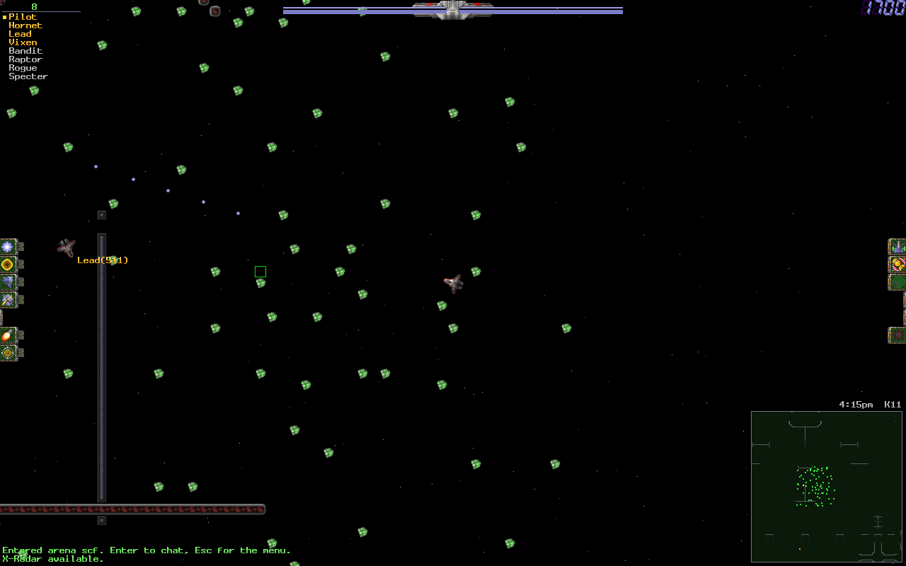
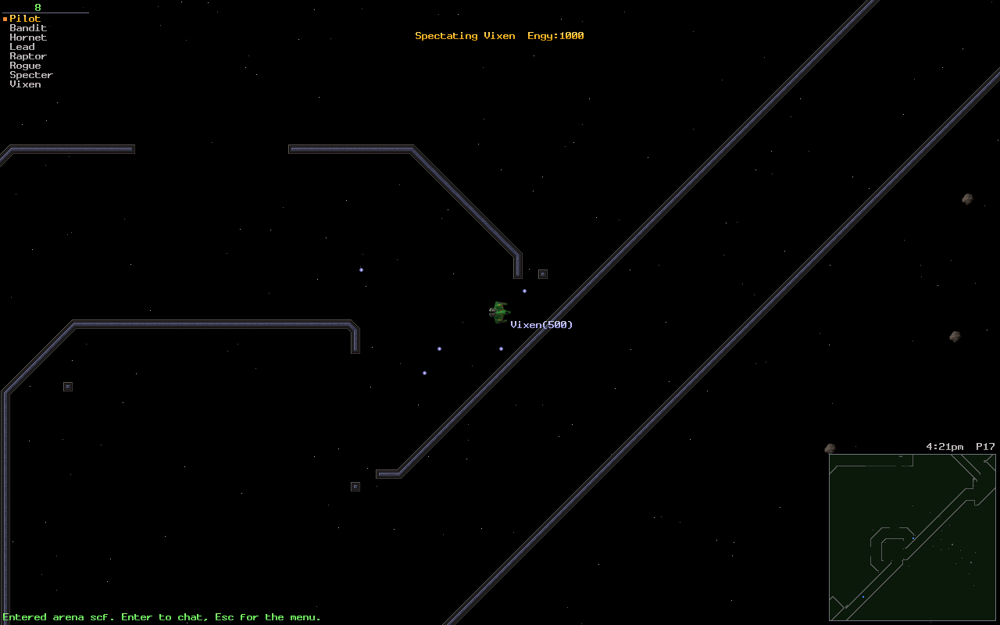
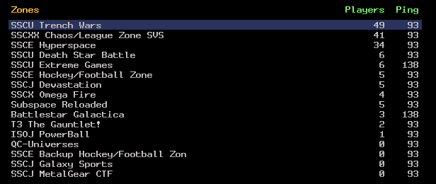

# oss-client

SubSpace is a top-down multiplayer space shooter from 1997. Ships drift; bullets and bombs
carry your momentum with them; a map is 1024×1024 tiles of asteroid and wall with flags to
take and a team to take them from. When the publisher walked away, the players kept the game
running themselves — and they still are, on a client called Continuum and on zones that have
been up for twenty years.

**`oss-client` is a new client for that game**, written from scratch in Rust. It speaks the
protocol the existing zones speak — it has played on a zone running **subgame**, the original
server software, and it plays on
[oss-server](https://github.com/DangerMouseUK/oss-server). It is cross-platform, it runs at
whatever resolution and refresh rate your display has, it takes a gamepad, and it does not
need a Continuum install to start: Continuum's own graphics and sounds are bundled in
`assets/classic` ([what they are, and whose](assets/classic/README.md)), and an install of
your own overrides them if you point at one.





*Both frames are this client, in the zone that ships with
[oss-server](https://github.com/DangerMouseUK/oss-server), taken with `--screenshot`.*

## The project

| Repository | What it is | Licence |
|---|---|---|
| [oss-core](https://github.com/DangerMouseUK/oss-core) | The shared half: packets, transport, map and settings formats, physics, and a conformance suite anyone can run | MIT |
| [oss-server](https://github.com/DangerMouseUK/oss-server) | The zone server. Runs an existing ASSS zone directory unchanged | GPL-2.0-or-later |
| **oss-client** — you are here | The game client, plus `oss-session` and a headless bot | GPL-2.0-or-later |

## Play

`oss-client` uses the shared crates in [oss-core](https://github.com/DangerMouseUK/oss-core)
as a **sibling checkout**, so clone both:

```sh
git clone https://github.com/DangerMouseUK/oss-core
git clone https://github.com/DangerMouseUK/oss-client
cd oss-client
cargo run --release
```

That opens the login screen: zone, name, password, arena, ship. **F3** there is the zone
browser, **F5** the offline sandbox. Or skip it and go straight in:

```sh
cargo run --release -p oss-client -- --server 127.0.0.1:5000 --name YourName --ship 1
```

The keys are Continuum's, so a returning player already has them in their hands. **F1**
in the game lists them — and lists *yours* if you have changed any, which is why it is
the place to look rather than a list written down somewhere. To talk, just type: the
characters go to the chat line as they do in SubSpace and Continuum, and Enter sends.
[docs/playing.md](docs/playing.md) has the rest — the chat prefixes, the commands the
client answers itself, macros and replays.

No zone to hand? Run one: [oss-server](https://github.com/DangerMouseUK/oss-server) with no
arguments is a working zone on port 5000. Or fly on your own:

```sh
cargo run --release -p oss-client -- --sandbox
cargo run --release -p oss-client -- --sandbox path/to/map.lvl
```

### The zone browser



*Live zones, their populations and their pings, from the public directory servers — after
adding them, because the client ships with none.*

F3 on the login screen lists zones from the directory servers you configure, with population,
ping and the zone's own description. **None are configured by default** — the client contacts
nothing you have not asked it to. Add them with `[directory] servers = host:port` in the
settings file, or `--directory host:port`.

## Why you would trust it

A claim here names its evidence.

**It plays on servers nobody here wrote.** On 2026-11-12 a stock `oss-client` binary —
nothing patched, no special build — joined a zone running **subgame**, the original SubSpace
server software, over VIE: logged in, took the arena settings, downloaded the map, entered
and flew. Against the same zone over Continuum's encryption, a headless bot on this
repository's own `oss-session` layer, with the cipher supplied by a private module (see
below), reached the arena with the map and settings loaded and nothing dropped in either
direction.

**It passes the protocol conformance suite's client checks.** oss-core's
[`oss-conformance`](https://github.com/DangerMouseUK/oss-core/blob/main/docs/conformance.md)
can act as a zone and check whatever connects to it. Run it, then point this client at it:

```sh
cargo run --release -p oss-conformance -- client --bind 127.0.0.1:5621   # in oss-core
cargo run --release -p oss-client -- --server 127.0.0.1:5621 --name ConfTest --ship 1
```

```
group                           pass    fail    skip
client                            15       0       0
15 passed, 0 failed, 0 skipped
```

**Its physics are the server's physics.** `oss-sim` — the deterministic 100 Hz integer
simulation of ships, weapons and collision — lives in
[oss-core](https://github.com/DangerMouseUK/oss-core) and is used by this client to predict
and by `oss-server` to validate. One body of code, no floating point, so prediction and
anti-cheat cannot drift apart into false positives. Every arena setting it reads, and where
the meaning of that setting was established, is written down in
[oss-sim's SETTINGS.md](https://github.com/DangerMouseUK/oss-core/blob/main/crates/oss-sim/SETTINGS.md).

**It reads Continuum's own files.** `oss-assets` decodes `.bm2` and `.wa2` as well as
`.bmp`, `.png`, `.jpg`, `.gif` and `.wav`, so `--continuum-dir` gives you the graphics and
sounds you have always played with. It is MIT, separately from the rest of this repository,
so bots and tools can reuse it.

**The modern transport was checked twice.** Connections try OpenSec (X25519 +
ChaCha20-Poly1305) and fall back to VIE. OpenSec's test vectors are reproduced by an
independent implementation written from the RFCs with no shared code; the spec and the keys
this client pins are described in [docs/encryption.md](docs/encryption.md). It has not had an
external cryptographic review.

## What works, and what does not

**Working today.** Login (including registering a new name), arena entry and `?go`, map,
LVZ and zone-news download with a per-server cache, the full renderer — ships, weapons,
bombs, mines, prizes, flags, the radar, the stat box, the HUD — flying and fighting with
client-side prediction, kills and scores, public, team, private, channel and squad chat with
Continuum's prefixes and `%` substitutions, macros, the menu, spectating and following,
attaching as a turret, the zone browser, recording and replaying a visit, a settings screen,
screenshots, colour-blind and high-contrast palettes, interface scaling, gamepads with
remapping, and an offline sandbox on any `.lvl` map.

**A client built from this repository cannot join zones that require Continuum's
encryption.** Continuum's key expansion is not public and this repository does not carry it,
which is deliberate rather than a gap waiting to be filled. Zones that accept VIE — which
includes zones running ASSS and the original server — are reachable, as are OpenSec zones.
The security path is a trait, so a build that supplies its own cipher can reach more without
anything here changing.
[docs/encryption.md](docs/encryption.md) says exactly what this means for you.

**A public zone may still turn you away for its own reasons.** The zones this client has
been played on are ones run locally — `oss-server`, and subgame, the original server
software. A live internet zone can also refuse you on account policy: many require a
registered account, and the ones that require Continuum are out of reach for the reason
above. The zone browser will list them and ping them either way.

**Packaging is not done.** There is no installer, no release binary, no container image and
no crates.io publication. Building from source, as above, is currently the only way in.

**Rough edges to expect.** The browser build is not there yet — the renderer is kept
WebGPU-compatible for it, but it is not built or tested. This is 0.1.x: it has been played
against the original server software and against this project's own, and it has not been
played by a hundred people at once.

## Reference

- [docs/playing.md](docs/playing.md) — keys, gamepad, chat prefixes, client-side commands,
  `%` substitutions, macros, the zone browser, replays, the sandbox.
- [docs/settings.md](docs/settings.md) — the settings file and where it lives, accessibility
  palettes and scaling, and the order graphics and sounds are looked up in.
- [docs/encryption.md](docs/encryption.md) — OpenSec and VIE, key pinning, per-zone identity
  keys, and the Continuum policy in full.
- [docs/testing.md](docs/testing.md) — `oss-bot`, a minimal local zone, a local directory
  server, and the flags that drive the client without hands.

Run `oss-client --help` for every flag.

## Crates

| Crate | What it is | Licence |
|---|---|---|
| `oss-client` | The game | GPL-2.0-or-later |
| `oss-session` | The client side of a game session over `oss-net`: login, arena entry, settings, map download and cache, security answers, players, positions, chat. Sans-IO, with a UDP driver | GPL-2.0-or-later |
| `oss-bot` | Headless client and load swarm, on `oss-session` | GPL-2.0-or-later |
| `oss-assets` | `.bm2`/`.bmp`/`.png`/`.jpg`/`.gif` and `.wa2`/`.wav` decoders, and the asset search path | MIT |

The simulation (`oss-sim`, MIT) lives in
[oss-core](https://github.com/DangerMouseUK/oss-core), shared with the server.

## Contributing

Issues and pull requests are welcome. The most useful thing you can bring is a difference
from Continuum that you can demonstrate — a setting that behaves differently, a packet the
client mishandles, a frame that does not look right next to the original. The project's habit
is that the source of a claim gets written down next to it.

Before sending a change, run all four:

```sh
cargo fmt
cargo clippy --workspace --all-targets -- -D warnings
cargo test --workspace
RUSTDOCFLAGS="-D warnings" cargo doc --workspace --no-deps --all-features
```

`cargo fmt` **without** `--all` here: `--all` takes its package list from `cargo metadata`,
which includes the sibling `../oss-core` checkout, and would rewrite that repository in
place. The doc gate is not optional and the other three do not stand in for it.

Never commit `Continuum.exe` or its DLLs, third-party zone downloads, or captures.

## Licence

GPL-2.0-or-later (see [`LICENSE`](LICENSE)). The `oss-assets` crate is MIT so that bots and
tools can reuse it. The split across the three repositories is deliberate:
[oss-core](https://github.com/DangerMouseUK/oss-core) is MIT so that anyone's bot, tool or
alternative client can build on it whatever licence they use, while the client and server
are GPL because they follow ASSS, whose own GPL source may be ported into them.

**The graphics and sounds in `assets/classic` are Continuum's own**, bundled so that the
client is playable from a fresh clone, as other SubSpace clients do. They are not this
project's work, they are **not covered by the GPL above**, and no ownership of them is
claimed — [assets/classic/README.md](assets/classic/README.md) says so in full. They are a
convenience rather than a dependency: point the client at a Continuum install or at your own
asset folder and it needs nothing from that directory.

SubSpace and Continuum are the names of the original games; this project is an independent,
compatible implementation and is not affiliated with their authors.
